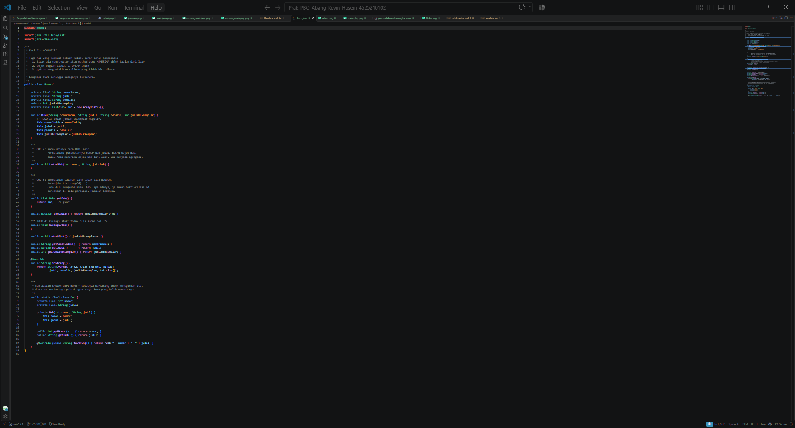
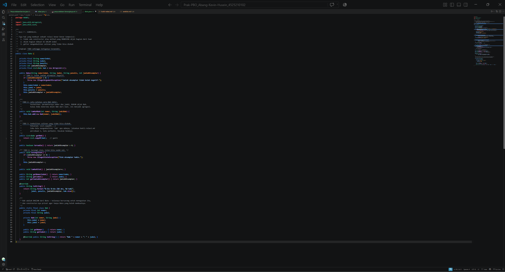
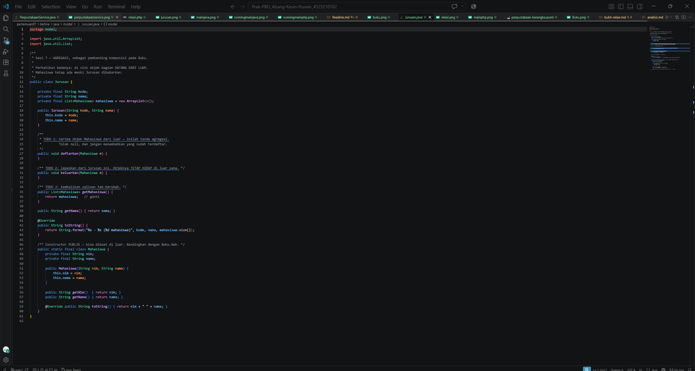
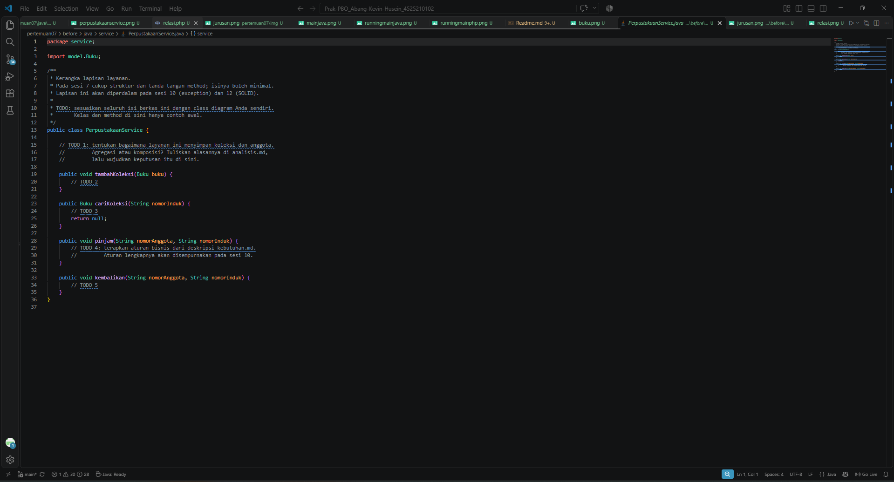
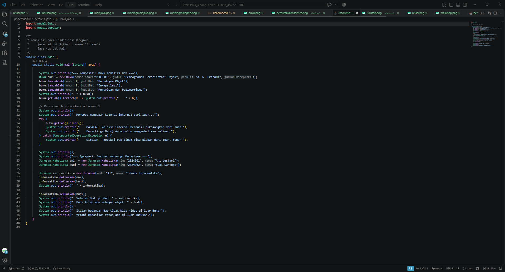
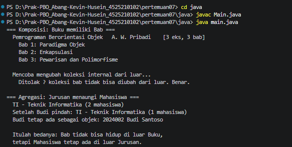
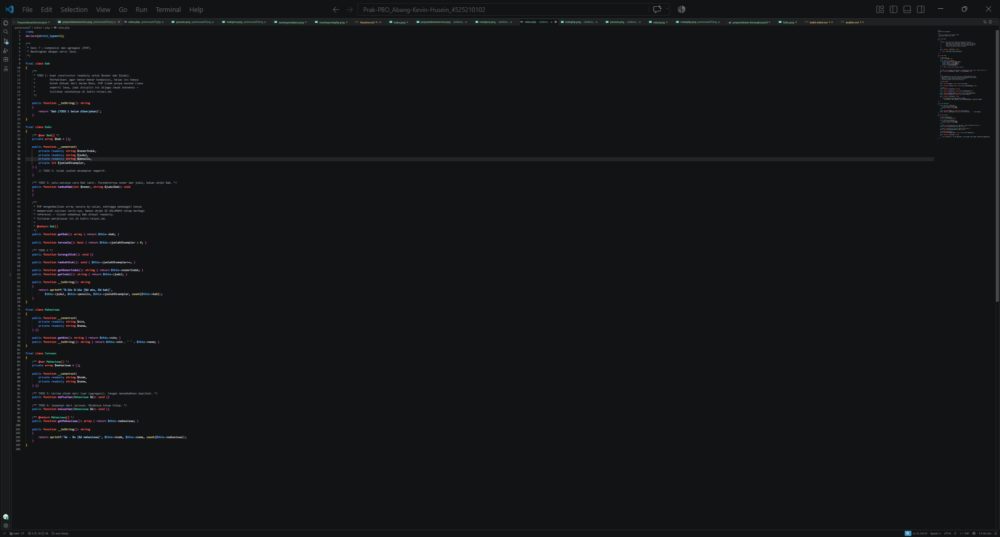
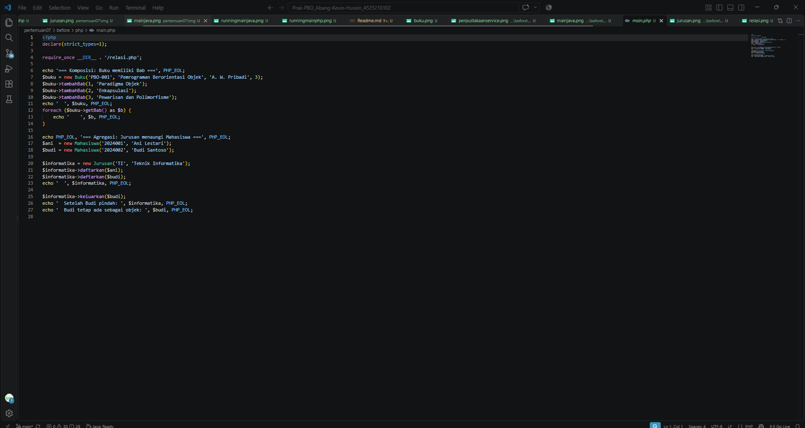
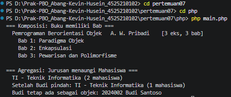
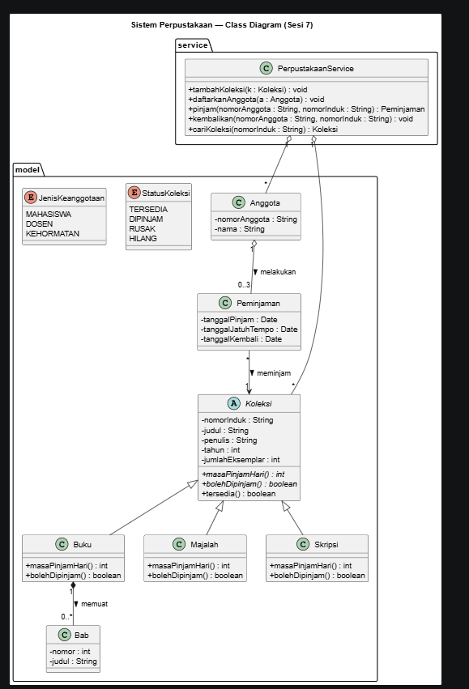

# LAPORAN PRAKTIKUM PEMROGRAMAN BERBASIS OBJEK

| Informasi Praktikan | Keterangan |
| :--- | :--- |
| **Nama** | Aulia Fachri |
| **NPM** | 4525210098 |
| **Kelas** | A |
| **Mata Kuliah** | Pemrograman Berorientasi Objek (PBO) |
| **Pertemuan** | 7 - Komposisi dan Agregasi |
| **Tanggal** | 15 Oktober 2026 |

---

## 1. Implementasi Java

### 1.1. File: `Buku.java`
**Penjelasan Kode:**
> Kelas `Buku` menerapkan relasi **komposisi** terhadap kelas bersarang (*nested class*) `Bab`. Kelas `Bab` dideklarasikan dengan *private constructor* sehingga objek `Bab` hanya dapat dibuat dari dalam kelas `Buku` melalui method `tambahBab(int, String)`. Method `getBab()` mengembalikan salinan koleksi yang tidak dapat diubah (*unmodifiable list*) menggunakan `List.copyOf(...)` untuk menjaga prinsip enkapsulasi dan mencegah manipulasi elemen internal dari luar kelas.

**Bukti Eksekusi (Screenshot):**
- **Before** *(Kondisi awal / Belum diimplementasi)*:

- **After** *(Kondisi akhir / Eksekusi berhasil)*:

### 1.2. File: `Jurusan.java`
**Penjelasan Kode:**
> Kelas `Jurusan` menerapkan relasi **agregasi** terhadap kelas `Mahasiswa`. Berbeda dari komposisi, objek `Mahasiswa` dibuat di luar kelas `Jurusan` dan didaftarkan melalui method `daftarkan(Mahasiswa m)`. Objek `Mahasiswa` dapat dilepaskan menggunakan method `keluarkan(Mahasiswa m)` dan tetap hidup secara mandiri meskipun telah dilepas dari `Jurusan`.

**Bukti Eksekusi (Screenshot):**
- **Before** *(Kondisi awal / Belum diimplementasi)*:

- **After** *(Kondisi akhir / Eksekusi berhasil)*:

### 1.3. File: `PerpustakaanService.java`
**Penjelasan Kode:**
> `PerpustakaanService` merupakan kelas layanan yang mengelola koleksi buku dan transaksi perpustakaan. Relasi antara `PerpustakaanService` dengan `Buku` bersifat **agregasi**, di mana buku terdaftar dalam list koleksi internal dan dapat dicari berdasarkan nomor induk, dipinjam (mengurangi stok), serta dikembalikan (menambah stok).

**Bukti Eksekusi (Screenshot):**
- **Before** *(Kondisi awal / Belum diimplementasi)*:

- **After** *(Kondisi akhir / Eksekusi berhasil)*:

### 1.4. File: `Main.java`
**Penjelasan Kode:**
> File `Main.java` berfungsi sebagai *entry point* pengujian. File ini mendemonstrasikan penambahan `Bab` pada `Buku`, membuktikan imutabilitas getter `getBab()` (panggilan `clear()` memicu `UnsupportedOperationException`), serta menguji alur pendaftaran dan pengeluaran `Mahasiswa` pada kelas `Jurusan`.

**Bukti Eksekusi (Screenshot):**
- **Before** *(Kondisi awal / Belum diimplementasi)*:

- **After** *(Kondisi akhir / Eksekusi berhasil)*:

### Output Java
**Output Program:**

> **Penjelasan Output:** Program berhasil menampilkan data buku beserta bab-babnya, menolak manipulasi koleksi `Bab` dari luar (pembuktian enkapsulasi komposisi), serta menampilkan dinamika pendaftaran dan pengeluaran mahasiswa tanpa menghancurkan objek mahasiswa itu sendiri.

---

## 2. Implementasi PHP

### 2.1. File: `relasi.php`
**Penjelasan Kode:**
> File ini berisi implementasi struktur Komposisi dan Agregasi di PHP. Kelas `Bab` dibuat menggunakan properti `readonly`. Kelas `Buku` mengasuh `Bab` secara komposisi lewat method `tambahBab()`. Kelas `Jurusan` menerapkan agregasi terhadap `Mahasiswa` dengan mencegah duplikasi pendaftaran dan menyediakan mekanisme pengeluaran objek menggunakan `array_filter`.

**Bukti Eksekusi (Screenshot):**
- **Before** *(Kondisi awal / Galat logika)*:

- **After** *(Kondisi akhir / Eksekusi berhasil)*:

### 2.2. File: `main.php`
**Penjelasan Kode:**
> Berfungsi sebagai skrip utama eksekusi PHP yang mengimpor `relasi.php`. Skrip ini menguji pembentukan komposisi `Buku` dan `Bab`, melakukan iterasi pendaftaran mahasiswa pada `Jurusan`, serta membuktikan bahwa objek `Mahasiswa` tetap ada di memori meskipun telah dikeluarkan dari objek `Jurusan`.

**Bukti Eksekusi (Screenshot):**
- **Before** *(Kondisi awal / Galat logika)*:

- **After** *(Kondisi akhir / Eksekusi berhasil)*:

### Output PHP
**Output Program:**

> **Penjelasan Output:** Eksekusi program PHP berjalan lancar, berhasil menampilkan struktur komposisi buku beserta babnya serta membuktikan bahwa objek `Mahasiswa` tetap berdiri sendiri di luar objek `Jurusan`.

---

## 3. Diagram UML & Dokumentasi Analisis

### 3.1. File: `perpustakaan-class.puml`
**Penjelasan Kode:**
> Merupakan pemodelan Class Diagram menggunakan PlantUML. Menerapkan hierarki pewarisan `Koleksi` (`Buku`, `Majalah`, `Skripsi`), relasi **komposisi** (`Buku` `*--` `Bab`), relasi **agregasi** (`Anggota` `o--` `Peminjaman`, `PerpustakaanService` `o--` `Koleksi`), serta enum `StatusKoleksi` dan `JenisKeanggotaan`.

**Bukti Gambar Diagram:**

### 3.2. File: `bukti-relasi.md`
**Penjelasan Kode:**
> Berisi dokumen pembuktian dan evaluasi perbedaan teknis antara proteksi imutabilitas koleksi pada Java (menggunakan `List.copyOf`) dan PHP (menggunakan pemanggilan *by-value array* serta properti `readonly`).

### 3.3. File: `analisis.md`
**Penjelasan Kode:**
> Berisi dokumen analisis domain kebutuhan sistem perpustakaan, identifikasi kata benda/kata kerja, penetapan invarian/aturan bisnis, serta dasar pertimbangan penentuan relasi agregasi pada `PerpustakaanService`.

---

## 4. Kesimpulan
> Pada praktikum Pertemuan 7 ini, pemahaman mendalam mengenai dua jenis relasi *has-a* (kepemilikan) yaitu **Komposisi** dan **Agregasi** telah berhasil diimplementasikan:
> 1. **Komposisi** merupakan relasi kepemilikan erat (*strong ownership*) di mana siklus hidup (*lifecycle*) objek bagian sangat bergantung pada objek induknya (seperti `Buku` dan `Bab`). Objek bagian tidak diciptakan di luar induk dan koleksi internalnya dilindungi dari modifikasi eksternal.
> 2. **Agregasi** merupakan relasi kepemilikan longgar (*weak ownership*) di mana objek bagian diciptakan di luar wadah dan dapat terus berdiri sendiri meskipun dilepas dari objek wadahnya (seperti `Jurusan` dan `Mahasiswa`).
> 3. Penerapan proteksi koleksi seperti `List.copyOf(...)` pada Java dan properti `readonly` pada PHP sangat krusial untuk menjaga prinsip enkapsulasi objek.