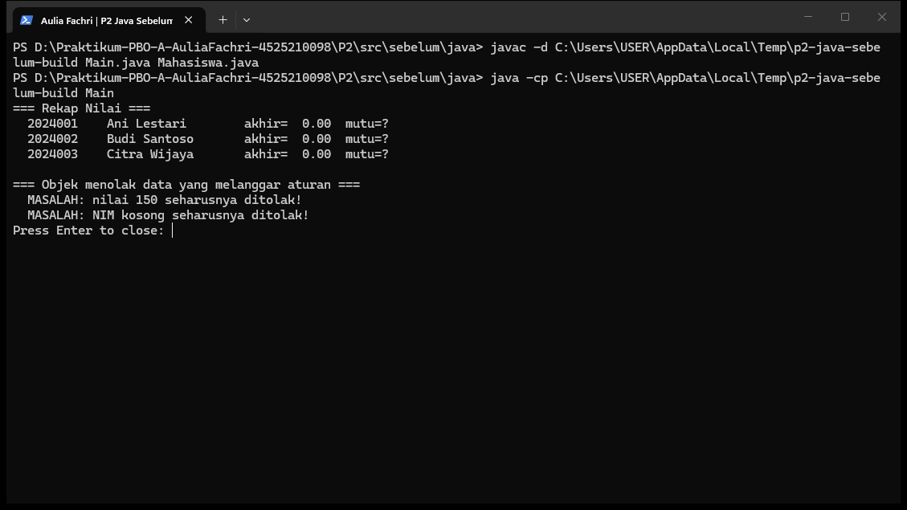
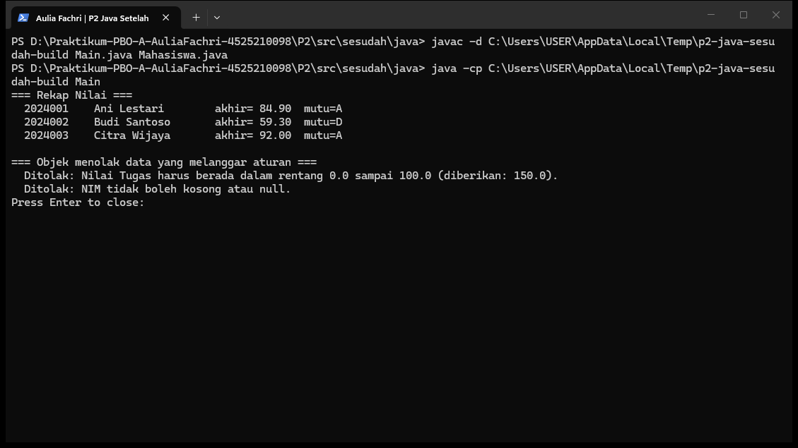
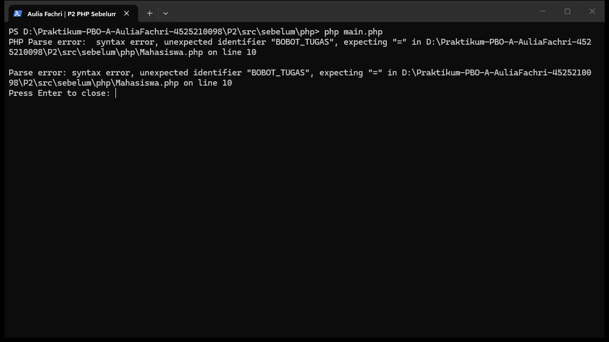
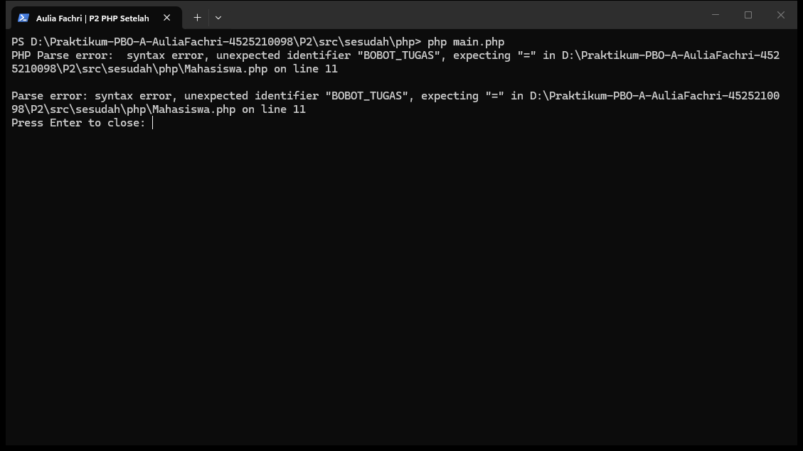

# Praktikum 02 — Kelas, Objek, dan Enkapsulasi

* **Nama:** Aulia Fachri
* **NPM:** 4525210098
* **Kelas:** A
* **Dosen Pengampu:** Adi Wahyu Pribadi, S.Si., M.Kom

---

## A. Ringkasan Tugas
Praktikum sesi ini berfokus pada penerapan prinsip **Pemrograman Berorientasi Objek (PBO)** khususnya **Enkapsulasi** dan pemeliharaan **Invariant** (aturan yang harus selalu benar sepanjang siklus hidup objek). Kita mengimplementasikan kelas `Mahasiswa` dalam bahasa **Java** dan **PHP (8.4+)** dengan memastikan validasi data dilakukan di dalam objek itu sendiri, bukan di kelas penguji (`Main` / `main`).

---

## B. Penjelasan Perubahan & Pengerjaan TODO (`Mahasiswa.java`)

Berikut adalah rincian perubahan dan alasan teknis pada setiap bagian `TODO` di berkas `Mahasiswa.java`:

1. **TODO 1: Deklarasi Atribut & Immutability**
   * **Yang Diubah:** Mendeklarasikan `nim` dan `nama` dengan tambahan kata kunci `final`, serta atribut nilai (`nilaiTugas`, `nilaiUts`, `nilaiUas`) sebagai `private`.
   * **Tujuan:** Menerapkan enkapsulasi penuh dan memastikan NIM bersifat tetap (*immutable*) sesuai invariant bahwa NIM tidak pernah berubah setelah mahasiswa terdaftar. Penggunaan `private` mencegah akses langsung dari luar kelas.

2. **TODO 2: Validasi NIM**
   * **Yang Diubah:** Menambahkan pengecekan `if (nim == null || nim.trim().isEmpty())` di dalam *constructor*.
   * **Tujuan:** Menolak data NIM yang kosong atau bernilai `null` sejak awal pembuatan objek, lalu melemparkan `IllegalArgumentException` dengan pesan kesalahan yang spesifik.

3. **TODO 3 & 4: Validasi Komponen Nilai**
   * **Yang Diubah:** Membuat method pembantu privat `pastikanNilaiSah(String namaKomponen, double nilai)` dan memanggilnya di *constructor* untuk setiap komponen nilai (Tugas, UTS, UAS).
   * **Tujuan:** Menghindari duplikasi kode (*Dry Principle*). Method ini memastikan setiap nilai berada pada rentang $0 \le \text{nilai} \le 100$. Jika melanggar, objek menolak data tersebut secara langsung pada tahap *runtime*.

4. **TODO 5: Perhitungan Nilai Akhir**
   * **Yang Diubah:** Mengimplementasikan rumus perhitungan menggunakan konstanta bobot yang sudah disediakan:
     $$\text{Nilai Akhir} = (\text{Tugas} \times 0.30) + (\text{UTS} \times 0.30) + (\text{UAS} \times 0.40)$$
   * **Tujuan:** Menjaga kebersihan kode tanpa menulis angka ajaib (*magic numbers*) di dalam method.

5. **TODO 6: Penentuan Huruf Mutu**
   * **Yang Diubah:** Membuat percabangan kondisi untuk mengonversi nilai akhir menjadi predikat huruf: $\ge 80 \to "A"$, $\ge 70 \to "B"$, $\ge 60 \to "C"$, $\ge 50 \to "D"$, selain itu $"E"$.
   * **Tujuan:** Menyediakan perilaku bisnis standar akademik yang dikemas rapi di dalam kelas objek.

6. **TODO 7: Penyediaan Getter**
   * **Yang Diubah:** Menambahkan *getter* untuk atribut yang diperlukan (`getNim()`, `getNama()`, dll.) **tanpa** membuat method *setter* untuk `nim`.
   * **Tujuan:** Melindungi integritas data (*read-only access*) dari dunia luar.

---

## C. Penjelasan Perubahan & Pengerjaan TODO (`Mahasiswa.php`)

Penyesuaian pada versi PHP (`Mahasiswa.php`) menggunakan standar fitur modern PHP 8.4+:
* **Constructor Property Promotion & Readonly:** Atribut `nim` dan `nama` dideklarasikan langsung di dalam parameter *constructor* menggunakan kata kunci `private readonly`, yang bertindak sebagai padanan kata kunci `final` pada Java.
* **Strict Types:** Menggunakan `declare(strict_types=1);` di baris pertama agar PHP tidak melakukan konversi tipe data implisit secara diam-diam.
* **Match Expression:** Pada penentuan huruf mutu, digunakan ekspresi `match (true)` agar kode lebih bersih, ekspresif, dan mudah dibaca dibandingkan `if-else` bertumpuk.

---

## D. Hasil Pengujian Program (Running)

Berikut adalah bukti hasil eksekusi program uji setelah seluruh `TODO` diselesaikan:

### 1. Java
* **Sebelum Perbaikan:**
   > 
* **Sesudah Perbaikan:**
   > 

### 2. PHP
* **Pemeriksaan PHP sebelum:** Kode typed class constants memerlukan PHP 8.4+, sedangkan runtime lokal PHP 8.2.12 berhenti pada parse error.
   > 
* **Pemeriksaan PHP sesudah:** Kondisi runtime sama; gambar ini bukan bukti eksekusi sukses.
   > 

---

## E. Kesimpulan
Melalui praktikum Sesi 02 ini, dapat disimpulkan bahwa penerapan enkapsulasi dan pengelolaan *invariant* yang benar di dalam kelas (*constructor* dan *method* internal) sangat penting untuk menjaga keabsahan data objek sejak pertama kali diciptakan. Objek kini mampu menolak data yang tidak sah (seperti nilai di luar rentang 0–100 atau NIM kosong) serta melindungi atribut tetap (*immutable*) dari modifikasi luar secara aman, baik pada bahasa Java maupun PHP.
