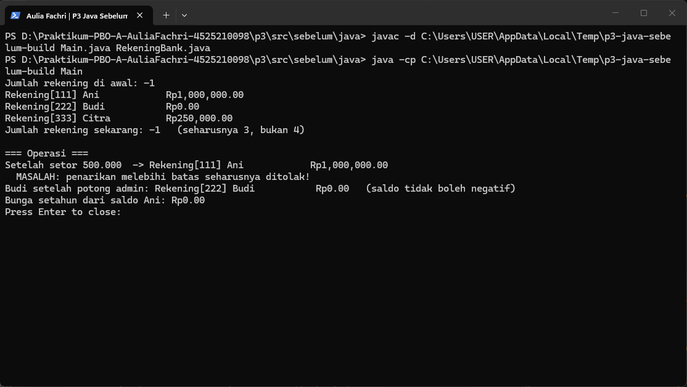
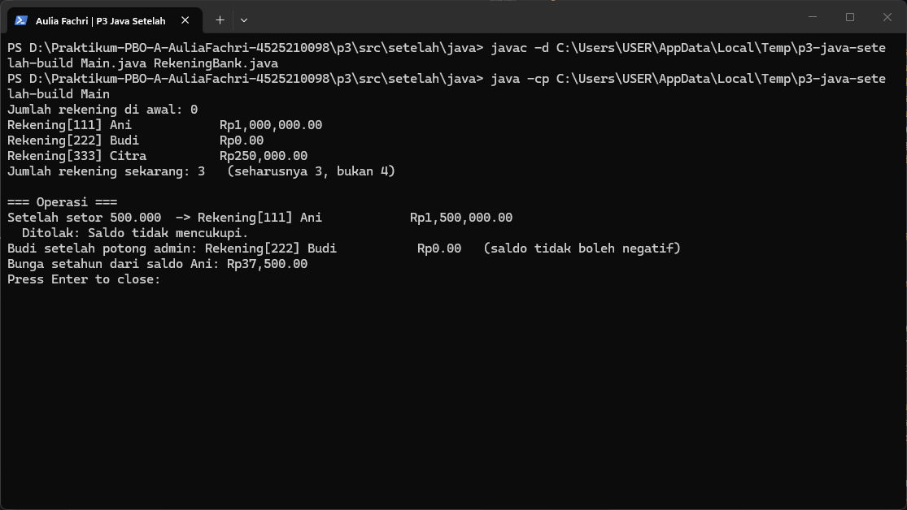
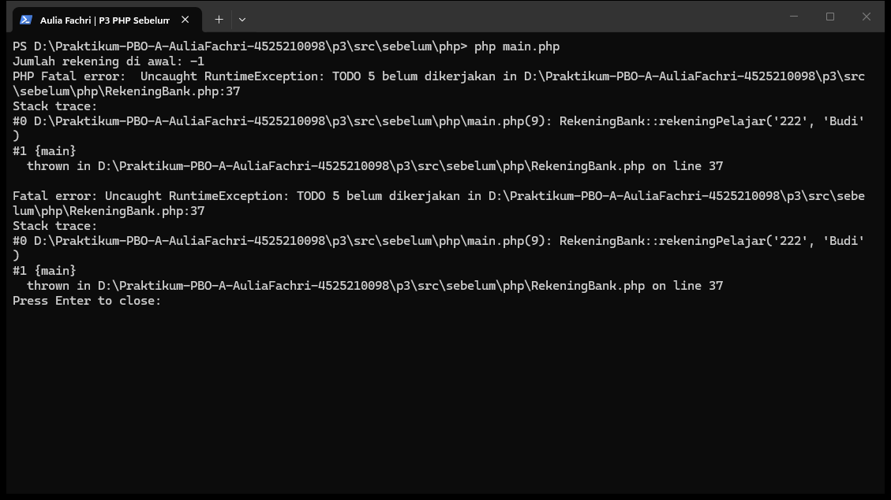
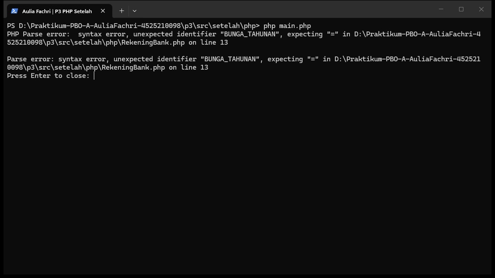

# Praktikum 03 — Constructor, Anggota Statis, dan Konstanta

- **Nama:** Aulia Fachri
- **NPM:** 4525210098
- **Kelas:** A
- **Dosen Pengampu:** Adi Wahyu Pribadi, S.Si., M.Kom

---

## A. Ringkasan Tugas
Praktikum sesi ini berfokus pada pemahaman siklus hidup objek, penerapan **Constructor Overloading** dengan teknik **Delegasi Constructor** (`this(...)` di Java / *default parameter* di PHP), pemanfaatan anggota statis (`static`) untuk data yang melekat pada kelas, serta penggunaan konstanta (`static final` / `const`) guna menghindari *"magic numbers"* (angka ajaib). Kita mengimplementasikan kelas `RekeningBank` dalam bahasa **Java** dan **PHP (8.4+)**.

---

## B. Penjelasan Perubahan & Pengerjaan TODO (`RekeningBank.java`)

Berikut adalah rincian perubahan dan alasan teknis pada setiap bagian `TODO` di berkas `RekeningBank.java`:

1. **TODO 1: Penggunaan Konstanta (Menghindari Angka Ajaib)**
   * **Yang Diubah:** Mendefinisikan konstanta `public static final double BUNGA_TAHUNAN = 0.025;`, `BIAYA_ADMIN = 5000;`, dan `BATAS_PENARIKAN = 5000000;`.
   * **Tujuan:** Menghindari angka literal yang tersebar di dalam method (*magic numbers*), sehingga memudahkan pemeliharaan kode jika ada perubahan kebijakan bisnis (misalnya persentase bunga atau biaya admin diubah).

2. **TODO 2: Deklarasi Field Statis (Penghitung Objek)**
   * **Yang Diubah:** Menambahkan atribut privat statis `private static int jumlahRekening = 0;`.
   * **Tujuan:** Menyediakan penghitung global yang dibagikan ke seluruh instance kelas untuk melacak total objek `RekeningBank` yang berhasil dibuat.

3. **TODO 3 & 4: Delegasi Constructor & Validasi Terpusat**
   * **Yang Diubah:** Mengubah *constructor* ringkas (dua parameter) agar mendelegasikan pembuatannya ke *constructor* lengkap menggunakan `this(nomor, pemilik, 0);`. Validasi untuk mendeteksi nomor rekening kosong dan saldo awal negatif dipusatkan hanya di dalam *constructor* lengkap.
   * **Tujuan:** Menerapkan prinsip DRY (*Don't Repeat Yourself*). Duplikasi aturan validasi dihilangkan sehingga aturan hanya perlu diubah di satu tempat jika diperlukan.

4. **TODO 5: Inkrementasi Penghitung Objek**
   * **Yang Diubah:** Menambahkan baris `jumlahRekening++;` **hanya** di dalam *constructor* lengkap.
   * **Tujuan:** Karena *constructor* ringkas melakukan delegasi ke *constructor* lengkap, penambahan jumlah rekening tidak akan dihitung dua kali secara keliru.

5. **TODO 6 & 7: Validasi Transaksi (Setor & Tarik)**
   * **Yang Diubah:** Menambahkan validasi pada method `setor()` (menolak nilai $\le 0$) serta method `tarik()` (menolak nilai $\le 0$, menolak jika melebihi saldo, dan menolak jika melebihi batas penarikan sekali transaksi).
   * **Tujuan:** Menjaga keabsahan transaksi dan menegakkan *invariant* saldo tidak boleh bernilai negatif serta kepatuhan terhadap batas maksimal penarikan.

6. **TODO 8: Pemotongan Biaya Admin**
   * **Yang Diubah:** Mengimplementasikan pemotongan saldo sebesar `BIAYA_ADMIN` dengan pengecekan agar saldo akhir tidak menjadi kurang dari nol.
   * **Tujuan:** Memastikan konsistensi keuangan akun sesuai aturan bisnis.

7. **TODO 9 & 10: Pembuatan Method Statis**
   * **Yang Diubah:** Membuat method statis `getJumlahRekening()` untuk mengembalikan nilai penghitung, dan method utilitas statis `bungaSetahun(double pokok)` untuk menghitung proyeksi bunga tahunan tanpa terikat pada instansiasi objek tertentu.
   * **Tujuan:** Membedakan dengan jelas antara perilaku yang melekat pada konteks *instance* (objek) versus konteks *class* (statis).

---

## C. Penjelasan Perubahan & Pengerjaan TODO (`RekeningBank.php`)

Penyesuaian pada versi PHP (`RekeningBank.php`) mengadaptasi karakteristik bahasa PHP modern (8.4+):
- **Konstanta Kelas:** Memanfaatkan keyword `public const` untuk mendefinisikan konstanta seperti `BUNGA_TAHUNAN`, `BIAYA_ADMIN`, dan `BATAS_PENARIKAN`.
- **Padanan Overloading:** Karena PHP tidak mendukung *constructor overloading* secara langsung, digunakan *default parameter* pada constructor utama (`float $saldoAwal = 0`).
- **Named Constructor:** Mengimplementasikan *static factory method* `rekeningPelajar()` yang menggunakan `new static()` (*late static binding*) agar fleksibel apabila kelas ini nantinya diturunkan (*inheritance*).
- **Pengecekan Tipe & Exception:** Menggunakan `declare(strict_types=1);` serta melempar `InvalidArgumentException` dan `RuntimeException` saat terjadi pelanggaran aturan validasi.

---

## D. Hasil Pengujian Program (Running)

Berikut adalah bukti hasil eksekusi program uji setelah seluruh `TODO` diselesaikan:

### 1. Java
* **Sebelum Perbaikan:**
   > 
* **Sesudah Perbaikan:**
   > 

### 2. PHP
* **Sebelum Perbaikan:**
   > 
* **Pemeriksaan versi setelah perbaikan:** Kode memakai typed class constants dan memerlukan PHP 8.4+, sedangkan runtime lokal versi 8.2.12 belum mendukung sintaks tersebut. Screenshot berikut menunjukkan ketidakcocokan runtime, bukan hasil eksekusi sukses.
   > 

---

## E. Kesimpulan
Melalui praktikum Sesi 03 ini, kita mempelajari pentingnya mengelola siklus hidup objek secara benar. Penerapan **delegasi constructor** efektif mencegah duplikasi kode validasi. Penggunaan **anggota statis** (`static`) memungkinkan pengelolaan data lintas objek secara terpusat (seperti pencatatan jumlah total rekening), sementara **konstanta** membersihkan kode dari ketergantungan pada angka ajaib (*magic numbers*) yang rawan kesalahan.